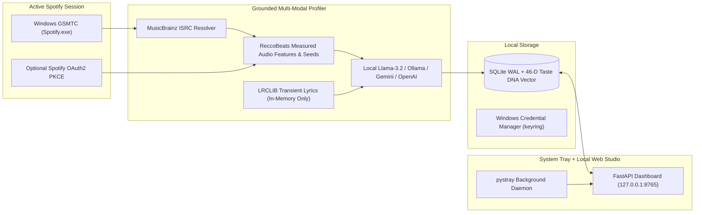

# PulseMind — Hyper-Personalized Spotify Play Tracker & Sonic DNA Studio

[](https://github.com/mini-mator/spotify-pulsemind/releases/latest)
[](#quick-start-direct-download--run)
[](#developer-setup)
[](LICENSE)

**PulseMind** is a lightweight Windows System Tray background tracker + Local Web Dashboard (`http://127.0.0.1:8765`) that automatically connects to your active **Spotify Desktop** app on boot, tracks your real listening behavior (full listens, early skips, repeat loops, and late-night sessions), analyzes the **measured beat structure** and **unconstrained lyrical message** of every song you play, and builds hyper-personalized playlists scored against your **46-Dimensional Taste DNA Vector**.

---

## Quick Start (Direct Download & Run Locally)

1. **[Download `PulseMind-v1.0.0-Windows-Portable.zip` from the Latest Release](https://github.com/mini-mator/spotify-pulsemind/releases/latest)** and extract the folder anywhere on your PC.
2. Double-click **`Start-PulseMind.bat`**.
   - *First run*: Automatically sets up a local `.venv`, installs dependencies, places a **PulseMind** shortcut on your Windows Desktop, starts the green pulse icon in your System Tray, and opens `http://127.0.0.1:8765`.
   - *Subsequent runs*: Boots silently in `< 1 second` via your Desktop shortcut (`PulseMind.lnk`) or `Start-PulseMind.bat`.
3. **Play any song in the Spotify Desktop app** — PulseMind connects to your active Windows Spotify session automatically with **zero API keys required**.

---

## Architecture & Core Features



### 1. Zero-Key Active Spotify Desktop Connection on Boot
- Automatically reads your live `Spotify.exe` session via **Windows Global System Media Transport Controls (GSMTC)** even when Spotify is minimized.
- Resolves `(Title, Artist)` -> **MusicBrainz ISRC** -> **ReccoBeats** to obtain the official **Spotify Track ID** (`https://open.spotify.com/track/...`) and measured audio features (`tempo` BPM, `energy`, `danceability`, `valence`, `acousticness`, `speechiness`, `loudness`) without needing a Spotify Developer account.
- Also supports optional **Spotify Web API OAuth2 PKCE** (`http://127.0.0.1:8765/callback` — no client secret needed) for backfilling the last 50 played tracks and one-click private playlist export (`playlist-modify-private`).

### 2. Unconstrained Song-Specific Lyrical Message & Grounded Beat Analysis
- **Measured Audio First**: The LLM never invents BPM or energy; it receives measured audio metrics from ReccoBeats (or optional local `librosa` analysis) with explicit source and confidence tags.
- **Privacy-First Transient Lyrics**: Fetches plain lyrics from **LRCLIB** in-memory only and **never persists raw lyrics to SQLite/disk**.
- **Unconstrained Thematic Headlines + 46-D Vector Indexing**:
  - Automatically launches your local Ollama `llama-server.exe` (`Llama-3.2` GGUF) in the background (or connects to Ollama / Gemini / OpenAI) to craft a **bespoke, unconstrained `specific_theme_headline`**, **`music_message`**, **`key_lyric_motif`**, and **`emotional_arc`** unique to each song.
  - Maps the song into a **46-dimensional unit vector** (`8 continuous sonic metrics` + `15 Beat Archetypes` + `23 Lyrical Macro-Themes`) for deterministic **Cosine Similarity** scoring.

### 3. Behavioral Play Tracking & Exponential-Decay Taste DNA
- **Skip Detection**: Tracks `max_progress_ms / duration_ms` when tracks change; listens under `30s` or `< 50%` completion are flagged as **Skipped** and down-weighted (`0.15x`).
- **Repeat-Loop Detection**: Detects when the same track restarts near `0s` after playing `>= 30s`, incrementing the repeat loop counter (`+0.45x` bonus per loop).
- **Exponential Time Decay & Late-Night Boost**: Recent listens weigh more (configurable half-life, default `14 days`), and tracks played between `22:00–04:00` receive a `1.35x` late-night multiplier.

---

## Developer Setup & Running Tests

```powershell
# Clone the repository
git clone https://github.com/mini-mator/spotify-pulsemind.git
cd spotify-pulsemind

# Install dependencies
python -m pip install -r requirements.txt

# Run the unit & end-to-end test suite
python -m pytest tests/test_core.py -v

# Launch System Tray + Web Dashboard (http://127.0.0.1:8765)
python tray.py
```

---

## Project Structure

- `tray.py` — Windows System Tray daemon (`pystray`) + single-instance guard + background `uvicorn` server launcher.
- `app.py` — FastAPI REST backend & static SPA host (`http://127.0.0.1:8765`).
- `spotify_client.py` — Windows GSMTC active `Spotify.exe` session reader, MusicBrainz -> ReccoBeats Spotify ID resolver, and Spotify OAuth2 PKCE wrapper.
- `tracker.py` — Playback state machine with skip detection, repeat-loop detection, and gap backfill.
- `analyzer.py` — ReccoBeats audio feature fetcher, LRCLIB transient lyric fetcher, auto-managed local `llama-server.exe` LLM client, and 21-lexicon chorus/motif extractor.
- `recommender.py` — Exponential-decay Taste DNA calculator and Cosine Similarity candidate scorer.
- `schemas.py` — Pydantic models, 15 Beat Archetypes, 23 Lyrical Macro-Themes, and 46-D vector math.
- `database.py` — Thread-safe SQLite `WAL` storage with single-writer `RLock`.
- `config.py` — Settings model and OS Credential Manager (`keyring`) secret storage.
- `Start-PulseMind.bat` & `create_shortcut.py` — End-user one-click bootstrap and Windows Desktop shortcut creator.
